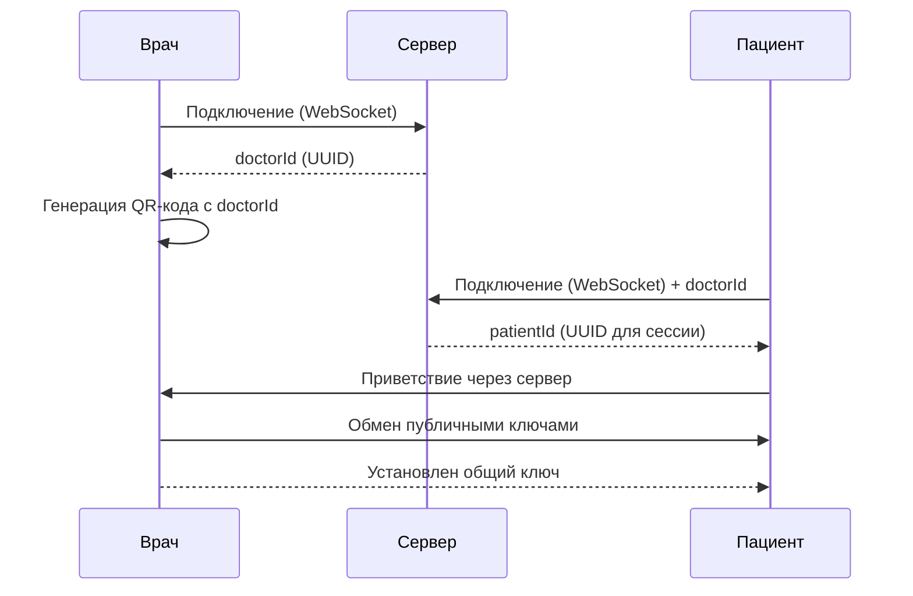

# Архитектура MedChat

## Обзор

MedChat реализует **децентрализованную архитектуру** с минимальным центральным сервером, который выполняет только функцию маршрутизации зашифрованных сообщений. Все персональные данные и история чатов хранятся исключительно на устройствах участников.

## Компоненты системы

### 1. Сервер-маршрутизатор (WebSocket Server)

**Назначение:**
- Маршрутизация зашифрованных сообщений между устройствами
- Генерация уникальных идентификаторов для врачей
- Генерация QR-кодов и ссылок для подключения пациентов
- Поддержка WebSocket соединений

**Что НЕ делает сервер:**
- ❌ Не хранит персональные данные
- ❌ Не хранит историю чатов
- ❌ Не расшифровывает сообщения
- ❌ Не аутентифицирует пользователей

**Технологии:**
- Node.js
- WebSocket (ws library)
- UUID для генерации идентификаторов
- QR Code библиотека для генерации кодов

### 2. Клиент врача (React Native)

**Функционал:**
- Генерация QR-кода и ссылки для пациентов
- Просмотр списка пациентов (локально)
- Чат с пациентами
- Загрузка файлов к карточкам пациентов (только для врача)
- Настройка уведомлений
- Управление доступом к сообщениям

**Хранение данных:**
- SQLite базы данных на устройстве
- Локальное хранение ключей шифрования
- Кэш сообщений и файлов

### 3. Клиент пациента (React Native)

**Функционал:**
- Сканирование QR-кода или ввод ссылки врача
- Ввод уникального логина (для идентификации врачом)
- Чат с врачом
- Просмотр истории сообщений (локально)

**Хранение данных:**
- SQLite базы данных на устройстве
- Локальное хранение ключей шифрования

## Протокол обмена сообщениями

### 1. Установление соединения



### 2. Формат сообщений

Все сообщения передаются в зашифрованном виде через сервер:

```json
{
  "type": "message",
  "from": "doctor|patient",
  "to": "doctorId|patientId",
  "timestamp": 1234567890,
  "encrypted": true,
  "data": "base64:encrypted_payload",
  "nonce": "base64:nonce_for_decryption"
}
```

### 3. Шифрование

Используется алгоритм **XChaCha20-Poly1305** (из libsodium):
- Обмен ключами: **X25519** (ECDH)
- Шифрование: **XChaCha20-Poly1305**
- Хэширование: **SHA-256**

**Процесс установления ключа:**
1. Врач генерирует пару ключей (приватный + публичный)
2. Пациент генерирует пару ключей
3. Обмен публичными ключами через сервер
4. Вычисление общего секретного ключа (ECDH)
5. Использование общего ключа для симметричного шифрования

## Модель данных

### Локальная база данных врача

```typescript
interface Doctor {
  id: string;              // UUID
  name: string;            // Имя врача
  specialty: string;       // Специальность
  settings: {
    notifications: boolean;
    autoReply: string | null;
    messageAccess: 'all' | 'selected';
  };
}

interface Patient {
  id: string;              // Уникальный логин (устанавливает пациент)
  doctorId: string;        // ID врача
  name: string | null;     // Имя пациента (опционально)
  createdAt: number;       // Timestamp
  lastMessageAt: number;   // Timestamp
  messages: Message[];
  files: PatientFile[];    // Файлы, доступные только врачу
}

interface Message {
  id: string;              // UUID
  content: string;         // Зашифрованный текст
  timestamp: number;
  from: 'doctor' | 'patient';
  status: 'sent' | 'delivered' | 'read';
  attachments: Attachment[];
}

interface PatientFile {
  id: string;
  name: string;
  type: string;
  size: number;
  path: string;            // Локальный путь к файлу
  uploadedAt: number;
  description: string | null;
}

interface Attachment {
  id: string;
  name: string;
  type: string;
  size: number;
  encrypted: boolean;
  key?: string;            // Ключ для расшифровки (если нужно)
}
```

### Локальная база данных пациента

```typescript
interface PatientProfile {
  id: string;              // Уникальный логин (вводит пациент)
  doctorId: string;        // ID врача из QR-кода
  doctorName: string | null;
  createdAt: number;
  messages: Message[];
}

interface Message {
  id: string;
  content: string;         // Зашифрованный текст
  timestamp: number;
  from: 'doctor' | 'patient';
  status: 'sent' | 'delivered' | 'read';
  attachments: Attachment[];
}
```

## Потоки данных

### 1. Регистрация врача

```
1. Врач открывает приложение
2. Приложение генерирует doctorId (UUID)
3. Приложение генерирует пару ключей (X25519)
4. Приложение подключается к серверу WebSocket
5. Сервер подтверждает подключение
6. Приложение генерирует QR-код с doctorId и публичным ключом
```

### 2. Подключение пациента

```
1. Пациент сканирует QR-код или переходит по ссылке
2. Приложение извлекает doctorId и публичный ключ врача
3. Пациент вводит уникальный логин (patientId)
4. Приложение генерирует пару ключей (X25519)
5. Приложение подключается к серверу WebSocket
6. Приложение отправляет doctorId и свой публичный ключ
7. Сервер маршрутизирует информацию врачу
8. Врач и пациент вычисляют общий секретный ключ
9. Устанавливается зашифрованный канал связи
```

### 3. Отправка сообщения

```
1. Пользователь пишет сообщение
2. Приложение шифрует сообщение общим ключом
3. Приложение отправляет зашифрованное сообщение на сервер
4. Сервер маршрутизирует сообщение получателю
5. Получатель расшифровывает сообщение
6. Приложение сохраняет сообщение локально
7. Приложение обновляет UI
```

### 4. Загрузка файлов (только для врача)

```
1. Врач выбирает файл для загрузки
2. Приложение шифрует файл (если нужно)
3. Приложение сохраняет файл локально
4. Приложение создает запись в базе данных
5. Файл доступен только врачу в карточке пациента
```

## Безопасность

Подробнее в [SECURITY.md](SECURITY.md)

### Уровни защиты:

1. **Транспортный уровень:**
   - WebSocket over TLS (wss://)
   - Сертификаты SSL/TLS

2. **Прикладной уровень:**
   - End-to-end шифрование (XChaCha20-Poly1305)
   - Уникальные ключи для каждой пары врач-пациент
   - Защита от replay-атаки (nonce)

3. **Хранение:**
   - Шифрование локальной базы данных
   - Защита ключей в ключевом хранилище устройства

4. **Аутентификация:**
   - Уникальные идентификаторы (UUID)
   - Подписи сообщений (опционально)

## Производительность

### Оптимизации:

1. **Локальное кэширование:**
   - Сообщения хранятся локально
   - Минимальные запросы к серверу

2. **Ленивая загрузка:**
   - Сообщения загружаются порциями
   - Старые сообщения подгружаются по требованию

3. **Сжатие данных:**
   - Сжатие сообщений перед шифрованием
   - Оптимизация передачи бинарных данных

4. **Оффлайн режим:**
   - Сообщения отправляются при восстановлении соединения
   - Локальное хранение неотправленных сообщений

## Масштабируемость

Сервер-маршрутизатор может быть масштабирован горизонтально:
- Использование Redis для синхронизации состояний между нодами
- Балансировка нагрузки (Nginx, HAProxy)
- Контейнеризация (Docker, Kubernetes)

## Отказоустойчивость

1. **Сервер:**
   - Автоматический рестарт при сбоях
   - Мониторинг состояния
   - Резервное копирование конфигурации

2. **Клиенты:**
   - Автоматическое переподключение при потере соединения
   - Локальное хранение неотправленных сообщений
   - Синхронизация при восстановлении соединения
